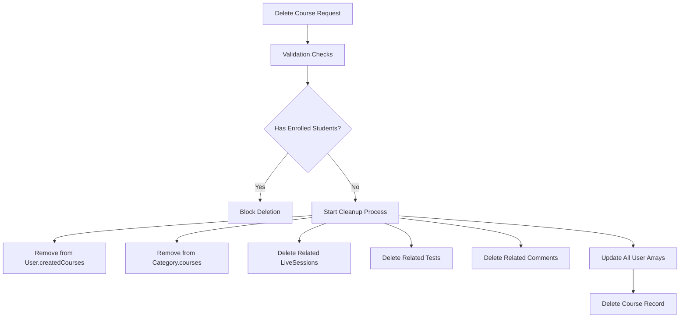

# Database and Model Relationships`n`n
## Data Storage Schemas`n`n
# Mentora Data Storage Schemas - Comprehensive Guide

## 📊 Database Schema Overview

This document consolidates all data storage schemas, models, and database structures used throughout the Mentora platform, focusing on financial and payment-related data storage.

## 💳 Course Purchase Data Storage

### Payment Model Schema (Unified Student → Admin, single finalizer)
```javascript
const paymentSchema = new mongoose.Schema({
  // Who pays and what
  userId: { type: mongoose.Schema.Types.ObjectId, ref: 'User', required: true },
  course: { type: mongoose.Schema.Types.ObjectId, ref: 'Course' },

  // Classification
  type: { type: String, enum: ['course_payment','billing_payment','annual_fee','commission_payment'], default: 'course_payment' },
  paymentSource: { type: String, enum: ['electronic','direct_transfer'], default: 'electronic' },
  recipientId: { type: mongoose.Schema.Types.ObjectId, ref: 'User' },

  // Amounts
  originalAmount: { type: Number },
  discount: { type: Number, default: 0 },
  finalAmount: { type: Number, required: true },

  // Fees and shares (standardized)
  adminPercentage: { type: Number, default: 10 },
  adminFeeFixed: { type: Number, default: 0 },
  adminFee: { type: Number, default: 0 },
  instructorAmount: { type: Number, default: 0 },

  // Direction
  transactionType: { type: String, enum: ['student_to_admin','student_to_instructor','admin_to_instructor','instructor_to_admin','billing_payment'] },

  // Method and status
  method: { type: String, enum: ['stripe','paypal','direct_transfer','credit_payment','cash'], default: 'stripe' },
  status: { type: String, enum: ['pending','pending_admin_approval','processing','completed','paid','failed','refunded','rejected','cancelled'], default: 'pending' },
  paidAt: Date,
  completedAt: Date,

  // Admin approval (for direct transfers)
  adminApproval: {
    required: { type: Boolean, default: false },
    approvedBy: { type: mongoose.Schema.Types.ObjectId, ref: 'User', default: null },
    approvedAt: Date,
    rejectedBy: { type: mongoose.Schema.Types.ObjectId, ref: 'User', default: null },
    rejectedAt: Date,
    adminNotes: String,
  },

  // Gateways
  stripePaymentIntentId: String,
  stripeSessionId: String,
  paypalOrderId: String,
  paypalPaymentId: String,
  paypalPayerId: String,

  // Payout tracking
  commissionPaidAmount: { type: Number, default: 0 },
  isCommissionSettled: { type: Boolean, default: false },

  // Soft-delete/void scaffolding
  isVoided: { type: Boolean, default: false },
  voidedAt: Date,
  voidReason: String,
  voidReversalId: { type: mongoose.Schema.Types.ObjectId, ref: 'BillingTransaction', default: null },

  // Misc
  metadata: { type: mongoose.Schema.Types.Mixed, default: {} },
}, { timestamps: true });
```

### Course Purchase Transaction Flow (Unified)
```javascript
// 1. Initiation (server-side calculation)
const payment = await Payment.create({
  userId: studentId,
  course: courseId,
  finalAmount: course.finalPrice,
  method: 'stripe',
  paymentSource: 'electronic',
});
payment.calculateShares();
await payment.save();

// 2. Gateway mapping
payment.stripeSessionId = session.id;
payment.stripePaymentIntentId = session.payment_intent;
await payment.save();

// 3. Finalization (authoritative)
payment.status = 'paid';
payment.paidAt = new Date();
await payment.save();
await payment.completePayment();
```

## 💰 Instructor Payout Data Storage

### InstructorBillingAccount Schema (with pendingEarnings/carryover)
```javascript
const instructorBillingAccountSchema = new mongoose.Schema({
  // Instructor Reference
  instructorId: {
    type: mongoose.Schema.Types.ObjectId,
    ref: "User",
    required: true,
    unique: true,
  },
  
  // Account Information
  accountType: {
    type: String,
    enum: ['free', 'paid'],
    default: 'free',
  },
  accountStatus: {
    type: String,
    enum: ['active', 'suspended', 'closed'],
    default: 'active',
  },
  
  // Financial Balances
  welcomeCredits: {
    type: Number,
    default: function() {
      return this.accountType === 'free' ? 100000 : 100;
    },
  },
  totalCommissionEarned: {
    type: Number,
    default: 0,
    min: 0,
  },
  totalPayoutsReceived: {
    type: Number,
    default: 0,
    min: 0,
  },
  pendingPayouts: { type: Number, default: 0, min: 0 },
  pendingEarnings: { type: Number, default: 0 },
  previousCarryover: { type: Number, default: 0 },
  totalApprovedPayouts: {
    type: Number,
    default: 0,
    min: 0,
  },
  adminCreditsAdded: {
    type: Number,
    default: 0,
    min: 0,
  },
  totalGiftAmount: {
    default: 0,
    min: 0,
  },
  
  // Fee Management
  // DEPRECATED (per-sale): owedAdminFees, totalAdminFeesPaid
  // Keep only for legacy/annual fee workflows if needed
  // TODO: Remove in future versions
  owedAdminFees: {
    type: Number,
    default: 0,
    min: 0,
  },
  totalAdminFeesPaid: {
    type: Number,
    default: 0,
    min: 0,
  },
  annualFees: {
    type: Number,
    default: 0,
    min: 0,
  },
  
  // Statistics
  statistics: {
    totalPaid: {
      type: Number,
      default: 0,
    },
    totalCharges: {
      type: Number,
      default: 0,
    },
    paymentCount: {
      type: Number,
      default: 0,
    },
    lastPaymentAmount: {
      type: Number,
      default: 0,
    },
    lastInstructorPaymentAmount: {
      type: Number,
      default: 0,
    },
    lastStudentPaymentAmount: {
      type: Number,
      default: 0,
    },
  },
  
  // Payout Requests
  payoutRequests: [{
    requestId: {
      type: mongoose.Schema.Types.ObjectId,
      default: () => new mongoose.Types.ObjectId(),
    },
    amount: {
      type: Number,
      required: true,
      min: 0,
    },
    method: {
      type: String,
      enum: ['bank_transfer', 'paypal', 'stripe'],
      required: true,
    },
    status: {
      type: String,
      enum: ['pending', 'approved', 'completed', 'rejected', 'cancelled'],
      default: 'pending',
    },
    requestDate: {
      type: Date,
      default: Date.now,
    },
    approvedDate: Date,
    completedDate: Date,
    notes: String,
    receiptUrl: String,
    bankDetails: {
      accountName: String,
      accountNumber: String,
      bankName: String,
      routingNumber: String,
    },
  }],
  
  // Fee Payments
  feePayments: [{
    amount: {
      type: Number,
      required: true,
      min: 0,
    },
    paymentMethod: {
      type: String,
      enum: ['bank_transfer', 'wire_transfer'],
      required: true,
    },
    receiptUrl: String,
    paidAt: {
      type: Date,
      default: Date.now,
    },
    verifiedBy: {
      type: mongoose.Schema.Types.ObjectId,
      ref: "User",
    },
    verifiedAt: Date,
    status: {
      type: String,
      enum: ['pending_verification', 'verified', 'rejected'],
      default: 'pending_verification',
    },
    description: String,
  }],
  
  // Timestamps
  createdAt: {
    type: Date,
    default: Date.now,
  },
  updatedAt: {
    type: Date,
    default: Date.now,
  },
});

// Virtual: Calculate Available Balance
instructorBillingAccountSchema.virtual('availableBalance').get(function() {
  return this.welcomeCredits + 
         this.totalCommissionEarned + 
         this.adminCreditsAdded + 
         this.totalGiftAmount - 
         this.totalPayoutsReceived - 
         this.pendingPayouts - 
         this.totalApprovedPayouts - 
         this.annualFees - 
         Math.max(0, this.owedAdminFees - this.totalAdminFeesPaid);
});
```

### PayoutRequest Schema
```javascript
const payoutRequestSchema = new mongoose.Schema({
  // Instructor Information
  instructorId: {
    type: mongoose.Schema.Types.ObjectId,
    ref: "User",
    required: true,
  },
  
  // Request Details
  amount: {
    type: Number,
    required: true,
    min: 0.01,
  },
  method: {
    type: String,
    enum: ['bank_transfer', 'paypal', 'stripe'],
    required: true,
  },
  description: String,
  
  // Bank Details (for bank transfers)
  bankDetails: {
    accountName: String,
    accountNumber: String,
    bankName: String,
    routingNumber: String,
    swiftCode: String,
  },
  
  // Status Management
  status: {
    type: String,
    enum: ['pending', 'approved', 'completed', 'rejected', 'cancelled'],
    default: 'pending',
  },
  
  // Processing Information
  approvedBy: {
    type: mongoose.Schema.Types.ObjectId,
    ref: "User",
  },
  processedBy: {
    type: mongoose.Schema.Types.ObjectId,
    ref: "User",
  },
  
  // Receipt Management
  receiptUrl: String,
  receiptUploadedAt: Date,
  receiptUploadedBy: {
    type: mongoose.Schema.Types.ObjectId,
    ref: "User",
  },
  
  // Timestamps
  requestDate: {
    type: Date,
    default: Date.now,
  },
  approvedAt: Date,
  completedAt: Date,
  rejectedAt: Date,
  
  // Notes
  instructorNotes: String,
  adminNotes: String,
  rejectionReason: String,
  
  // Related Records
  relatedBillingTransaction: {
    type: mongoose.Schema.Types.ObjectId,
    ref: "BillingTransaction",
  },
});
```

## 🔄 Refund Processing Data Storage

### RefundRequest Schema
```javascript
const refundRequestSchema = new mongoose.Schema({
  // User Information
  requesterId: {
    type: mongoose.Schema.Types.ObjectId,
    ref: "User",
    required: true,
  },
  requesterType: {
    type: String,
    enum: ['student', 'instructor'],
    required: true,
  },
  
  // Request Details
  refundType: {
    type: String,
    enum: ['course_purchase', 'admin_fee_overpayment', 'annual_fee', 'credit_refund'],
    required: true,
  },
  requestedAmount: {
    type: Number,
    required: true,
    min: 0.01,
  },
  originalAmount: {
    type: Number,
    required: true,
    min: 0,
  },
  reason: {
    type: String,
    required: true,
    maxlength: 500,
  },
  description: {
    type: String,
    maxlength: 1000,
  },
  
  // Related Records
  relatedCourse: {
    type: mongoose.Schema.Types.ObjectId,
    ref: "Course",
  },
  relatedPayment: {
    type: mongoose.Schema.Types.ObjectId,
    ref: "Payment",
  },
  relatedBillingTransaction: {
    type: mongoose.Schema.Types.ObjectId,
    ref: "BillingTransaction",
  },
  
  // Status Management
  status: {
    type: String,
    enum: ['pending', 'under_review', 'approved', 'rejected', 'processed', 'cancelled'],
    default: 'pending',
  },
  
  // Admin Processing
  reviewedBy: {
    type: mongoose.Schema.Types.ObjectId,
    ref: "User",
  },
  processedBy: {
    type: mongoose.Schema.Types.ObjectId,
    ref: "User",
  },
  adminNotes: {
    type: String,
    maxlength: 1000,
  },
  rejectionReason: {
    type: String,
    maxlength: 500,
  },
  
  // Supporting Documents
  supportingDocuments: [{
    fileName: {
      type: String,
      required: true,
    },
    fileUrl: {
      type: String,
      required: true,
    },
    fileSize: {
      type: Number,
      min: 0,
    },
    uploadedAt: {
      type: Date,
      default: Date.now,
    },
  }],
  
  // Financial Impact
  approvedAmount: {
    type: Number,
    min: 0,
  },
  processedAmount: {
    type: Number,
    min: 0,
  },
  refundMethod: {
    type: String,
    enum: ['account_credit', 'bank_transfer', 'original_payment_method'],
  },
  
  // Timestamps
  requestDate: {
    type: Date,
    default: Date.now,
  },
  reviewedAt: Date,
  approvedAt: Date,
  processedAt: Date,
  rejectedAt: Date,
  
  // Audit Trail
  statusHistory: [{
    status: {
      type: String,
      required: true,
    },
    changedBy: {
      type: mongoose.Schema.Types.ObjectId,
      ref: "User",
      required: true,
    },
    changedAt: {
      type: Date,
      default: Date.now,
    },
    notes: String,
  }],
  
  // Related Refund Transaction
  refundTransaction: {
    type: mongoose.Schema.Types.ObjectId,
    ref: "BillingTransaction",
  },
});
```

## 💳 Admin Fee Payment Data Storage

### AdminFeePayment Schema
```javascript
const adminFeePaymentSchema = new mongoose.Schema({
  // Instructor Information
  instructorId: {
    type: mongoose.Schema.Types.ObjectId,
    ref: "User",
    required: true,
  },
  
  // Payment Details
  paymentAmount: {
    type: Number,
    required: true,
    min: 0.01,
  },
  paymentDate: {
    type: Date,
    required: true,
  },
  paymentMethod: {
    type: String,
    enum: ['bank_transfer', 'wire_transfer', 'check'],
    required: true,
  },
  description: {
    type: String,
    maxlength: 500,
  },
  referenceNumber: {
    type: String,
    maxlength: 100,
  },
  
  // Receipt Documentation
  receiptUrl: {
    type: String,
    required: true,
  },
  receiptFileName: {
    type: String,
    required: true,
  },
  receiptFileSize: {
    type: Number,
    min: 0,
  },
  receiptUploadedAt: {
    type: Date,
    default: Date.now,
  },
  
  // Status Management
  status: {
    type: String,
    enum: ['pending', 'under_review', 'verified', 'approved', 'processed', 'rejected'],
    default: 'pending',
  },
  
  // Admin Processing
  reviewedBy: {
    type: mongoose.Schema.Types.ObjectId,
    ref: "User",
  },
  verifiedBy: {
    type: mongoose.Schema.Types.ObjectId,
    ref: "User",
  },
  approvedBy: {
    type: mongoose.Schema.Types.ObjectId,
    ref: "User",
  },
  processedBy: {
    type: mongoose.Schema.Types.ObjectId,
    ref: "User",
  },
  
  // Admin Notes
  verificationNotes: {
    type: String,
    maxlength: 1000,
  },
  approvalNotes: {
    type: String,
    maxlength: 1000,
  },
  rejectionReason: {
    type: String,
    maxlength: 500,
  },
  
  // Financial Impact
  outstandingFeesBeforePayment: {
    type: Number,
    required: true,
    min: 0,
  },
  outstandingFeesAfterPayment: {
    type: Number,
    required: true,
    min: 0,
  },
  allocatedToFees: {
    type: Number,
    required: true,
    min: 0,
  },
  excessAmount: {
    type: Number,
    default: 0,
    min: 0,
  },
  
  // Timestamps
  submittedAt: {
    type: Date,
    default: Date.now,
  },
  reviewedAt: Date,
  verifiedAt: Date,
  approvedAt: Date,
  processedAt: Date,
  rejectedAt: Date,
  
  // Related Records
  relatedBillingTransaction: {
    type: mongoose.Schema.Types.ObjectId,
    ref: "BillingTransaction",
  },
  relatedExcessCreditTransaction: {
    type: mongoose.Schema.Types.ObjectId,
    ref: "BillingTransaction",
  },
  
  // Audit Trail
  statusHistory: [{
    status: {
      type: String,
      required: true,
    },
    changedBy: {
      type: mongoose.Schema.Types.ObjectId,
      ref: "User",
      required: true,
    },
    changedAt: {
      type: Date,
      default: Date.now,
    },
    notes: String,
  }],
});
```

## 📊 Billing Transaction Schema

### BillingTransaction Schema
```javascript
const billingTransactionSchema = new mongoose.Schema({
  // User Reference
  userId: {
    type: mongoose.Schema.Types.ObjectId,
    ref: "User",
    required: true,
  },
  
  // Transaction Details
  type: {
    type: String,
    enum: ['credit', 'debit'],
    required: true,
  },
  amount: {
    type: Number,
    required: true,
    min: 0,
  },
  category: {
    type: String,
    enum: [
      'course_purchase', 'commission', 'admin_fee_received',
      'payout', 'instructor_payout', 'annual_fee', 'admin_fee_payment',
      'credit_addition', 'credit_payment', 'refund', 'refund_expense',
      'admin_fee', 'direct_transfer', 'payment_gateway'
    ],
    required: true,
  },
  description: {
    type: String,
    required: true,
    maxlength: 500,
  },
  
  // Balance Tracking
  balanceBefore: {
    type: Number,
    required: true,
  },
  balanceAfter: {
    type: Number,
    required: true,
  },
  
  // Status
  status: {
    type: String,
    enum: ['pending', 'completed', 'failed', 'cancelled', 'approved'],
    default: 'completed',
  },
  
  // Related Records
  relatedPayment: {
    type: mongoose.Schema.Types.ObjectId,
    ref: "Payment",
  },
  relatedCourse: {
    type: mongoose.Schema.Types.ObjectId,
    ref: "Course",
  },
  relatedPayoutRequest: {
    type: mongoose.Schema.Types.ObjectId,
    ref: "PayoutRequest",
  },
  relatedRefundRequest: {
    type: mongoose.Schema.Types.ObjectId,
    ref: "RefundRequest",
  },
  relatedAdminFeePayment: {
    type: mongoose.Schema.Types.ObjectId,
    ref: "AdminFeePayment",
  },
  
  // Processing Information
  processedBy: {
    type: mongoose.Schema.Types.ObjectId,
    ref: "User",
  },
  processedAt: {
    type: Date,
    default: Date.now,
  },
  
  // Additional Metadata
  metadata: {
    type: Map,
    of: mongoose.Schema.Types.Mixed,
  },
  
  // Timestamps
  createdAt: {
    type: Date,
    default: Date.now,
  },
  updatedAt: {
    type: Date,
    default: Date.now,
  },
});

// Indexes for Performance
billingTransactionSchema.index({ userId: 1, createdAt: -1 });
billingTransactionSchema.index({ category: 1, createdAt: -1 });
billingTransactionSchema.index({ status: 1 });
billingTransactionSchema.index({ relatedPayment: 1 });
```

## 🔍 Database Indexes and Performance

### Recommended Indexes
```javascript
// Payment Collection
db.payments.createIndex({ userId: 1, createdAt: -1 });
db.payments.createIndex({ courseId: 1 });
db.payments.createIndex({ status: 1 });
db.payments.createIndex({ method: 1 });
db.payments.createIndex({ stripeSessionId: 1 });

// InstructorBillingAccount Collection
db.instructorbillingaccounts.createIndex({ instructorId: 1 }, { unique: true });
db.instructorbillingaccounts.createIndex({ accountStatus: 1 });
db.instructorbillingaccounts.createIndex({ "payoutRequests.status": 1 });

// BillingTransaction Collection
db.billingtransactions.createIndex({ userId: 1, createdAt: -1 });
db.billingtransactions.createIndex({ category: 1, createdAt: -1 });
db.billingtransactions.createIndex({ status: 1 });
db.billingtransactions.createIndex({ relatedPayment: 1 });

// RefundRequest Collection
db.refundrequests.createIndex({ requesterId: 1, createdAt: -1 });
db.refundrequests.createIndex({ status: 1 });
db.refundrequests.createIndex({ refundType: 1 });
db.refundrequests.createIndex({ relatedPayment: 1 });

// AdminFeePayment Collection
db.adminfeepayments.createIndex({ instructorId: 1, createdAt: -1 });
db.adminfeepayments.createIndex({ status: 1 });
db.adminfeepayments.createIndex({ paymentDate: -1 });
```

## 🔧 Data Validation Rules

### Validation Middleware
```javascript
// Pre-save validation for financial consistency
billingTransactionSchema.pre('save', function(next) {
  // Validate balance calculation
  if (this.type === 'credit') {
    if (this.balanceAfter !== this.balanceBefore + this.amount) {
      return next(new Error('Invalid balance calculation for credit transaction'));
    }
  } else if (this.type === 'debit') {
    if (this.balanceAfter !== this.balanceBefore - this.amount) {
      return next(new Error('Invalid balance calculation for debit transaction'));
    }
  }
  next();
});

// Validate payout request amounts
payoutRequestSchema.pre('save', function(next) {
  if (this.amount <= 0) {
    return next(new Error('Payout amount must be positive'));
  }
  next();
});

// Validate refund amounts
refundRequestSchema.pre('save', function(next) {
  if (this.requestedAmount > this.originalAmount) {
    return next(new Error('Refund amount cannot exceed original amount'));
  }
  next();
});
```

## 📊 Data Aggregation Queries

### Common Aggregation Pipelines
```javascript
// Calculate instructor total earnings
const instructorEarnings = await BillingTransaction.aggregate([
  {
    $match: {
      userId: instructorId,
      category: 'commission',
      status: 'completed'
    }
  },
  {
    $group: {
      _id: null,
      totalEarnings: { $sum: '$amount' },
      transactionCount: { $sum: 1 }
    }
  }
]);

// Get monthly revenue breakdown
const monthlyRevenue = await Payment.aggregate([
  {
    $match: {
      status: 'paid',
      paidAt: {
        $gte: new Date(new Date().getFullYear(), 0, 1)
      }
    }
  },
  {
    $group: {
      _id: {
        year: { $year: '$paidAt' },
        month: { $month: '$paidAt' }
      },
      totalRevenue: { $sum: '$amount' },
      paymentCount: { $sum: 1 }
    }
  },
  {
    $sort: { '_id.year': 1, '_id.month': 1 }
  }
]);

// Calculate outstanding admin fees by instructor
const outstandingFees = await InstructorBillingAccount.aggregate([
  {
    $match: {
      owedAdminFees: { $gt: 0 }
    }
  },
  {
    $lookup: {
      from: 'users',
      localField: 'instructorId',
      foreignField: '_id',
      as: 'instructor'
    }
  },
  {
    $project: {
      instructorName: { $arrayElemAt: ['$instructor.name', 0] },
      instructorEmail: { $arrayElemAt: ['$instructor.email', 0] },
      outstandingAmount: '$owedAdminFees',
      totalPaid: '$totalAdminFeesPaid'
    }
  }
]);
```

---

*This comprehensive guide consolidates all data storage schemas and database structures used in the Mentora financial system.*


---

## Model Relationships


# 🔗 **Mentora Model Relationships & Integration Guide**

## 📋 **Table of Contents**
1. [Overview](#overview)
2. [Core Model Relationships](#core-model-relationships)
3. [Relationship Implementation](#relationship-implementation)
4. [Controller Integration](#controller-integration)
5. [Data Flow Examples](#data-flow-examples)
6. [Best Practices](#best-practices)
7. [Troubleshooting](#troubleshooting)

---

## 🎯 **Overview**

Mentora implements a comprehensive relationship system between all models to ensure data integrity, proper linking, and efficient querying. This guide explains how all models are interconnected and how relationships are maintained throughout the application lifecycle.

### **🔑 Key Principles:**
- **Bidirectional Relationships**: When A references B, B also references A
- **Automatic Updates**: Controllers automatically maintain relationships
- **Cascade Operations**: Deletions properly clean up all related data
- **Data Integrity**: Relationships prevent orphaned records
- **Financial Data Protection**: Critical financial relationships are protected from bulk deletion
- **Bulk Deletion Safety**: Non-financial data can be safely bulk deleted without affecting core relationships

---

## 🏗️ **Core Model Relationships**

### **👤 User Model Relationships**

```javascript
// User Schema Relationships
{
  // Course Relationships
  enrolledCourses: [{ type: ObjectId, ref: "Course" }],
  createdCourses: [{ type: ObjectId, ref: "Course" }],
  
  // Activity Relationships  
  liveSessions: [{ type: ObjectId, ref: "LiveSession" }],
  tests: [{ type: ObjectId, ref: "Test" }],
  comments: [{ type: ObjectId, ref: "Comments" }],
  
  // Financial Relationships
  payments: [{ type: ObjectId, ref: "Payment" }],
  certificates: [{ type: ObjectId, ref: "Certificate" }]
}
```

**🔗 User Relationships:**
- **1:N with Courses** (as instructor) → `createdCourses`
- **N:N with Courses** (as student) → `enrolledCourses`
- **1:N with LiveSessions** → `liveSessions`
- **1:N with Tests** → `tests`
- **1:N with Comments** → `comments`
- **1:N with Payments** → `payments`
- **1:N with Certificates** → `certificates`

### **📚 Course Model Relationships**

```javascript
// Course Schema Relationships
{
  // Core Relationships
  instructor: { type: ObjectId, ref: "User", required: true },
  category: { type: ObjectId, ref: "Category", required: true },
  enrolledStudents: [{ type: ObjectId, ref: "User" }],
  
  // Activity Relationships
  liveSessions: [{ type: ObjectId, ref: "LiveSession" }],
  tests: [{ type: ObjectId, ref: "Test" }],
  comments: [{ type: ObjectId, ref: "Comments" }],
  
  // Business Relationships
  payments: [{ type: ObjectId, ref: "Payment" }],
  enrollmentRequests: [{ type: ObjectId, ref: "EnrollmentRequest" }]
}
```

**🔗 Course Relationships:**
- **N:1 with User** (instructor) → `instructor`
- **N:1 with Category** → `category`
- **N:N with Users** (students) → `enrolledStudents`
- **1:N with LiveSessions** → `liveSessions`
- **1:N with Tests** → `tests`
- **1:N with Comments** → `comments`
- **1:N with Payments** → `payments`
- **1:N with EnrollmentRequests** → `enrollmentRequests`

### **🎥 LiveSession Model Relationships**

```javascript
// LiveSession Schema Relationships
{
  course: { type: ObjectId, ref: "Course", required: true },
  instructor: { type: ObjectId, ref: "User", required: true },
  participants: [{
    user: { type: ObjectId, ref: "User", required: true },
    joinedAt: { type: Date, default: Date.now }
  }]
}
```

**🔗 LiveSession Relationships:**
- **N:1 with Course** → `course`
- **N:1 with User** (instructor) → `instructor`
- **N:N with Users** (participants) → `participants`

### **💰 Payment Model Relationships**

```javascript
// Payment Schema Relationships
{
  userId: { type: ObjectId, ref: "User", required: true },
  course: { type: ObjectId, ref: "Course" },
  enrollmentRequest: { type: ObjectId, ref: "EnrollmentRequest" }
}
```

**🔗 Payment Relationships:**
- **N:1 with User** → `userId`
- **N:1 with Course** → `course`
- **N:1 with EnrollmentRequest** → `enrollmentRequest`

### **📝 Test Model Relationships**

```javascript
// Test Schema Relationships
{
  course: { type: ObjectId, ref: "Course", required: true },
  lesson: { type: ObjectId, ref: "Lesson" },
  instructor: { type: ObjectId, ref: "User", required: true },
  submissions: [{
    student: { type: ObjectId, ref: "User", required: true }
  }]
}
```

**🔗 Test Relationships:**
- **N:1 with Course** → `course`
- **N:1 with Lesson** → `lesson`
- **N:1 with User** (instructor) → `instructor`
- **N:N with Users** (students via submissions) → `submissions`

### **💬 Comments Model Relationships**

```javascript
// Comments Schema Relationships
{
  user: { type: ObjectId, ref: "User", required: true },
  course: { type: ObjectId, ref: "Course", required: true }
}
```

**🔗 Comments Relationships:**
- **N:1 with User** → `user`
- **N:1 with Course** → `course`

---

## ⚙️ **Relationship Implementation**

### **🔄 Automatic Relationship Updates**

When creating, updating, or deleting records, controllers automatically maintain bidirectional relationships:

#### **✅ Course Creation Example:**
```javascript
// courseController.js - createCourse function
const course = await Course.create({
  title,
  description,
  instructor: req.user._id,
  category: categoryDoc._id,
  // ... other fields
});

// 🔗 UPDATE RELATIONSHIPS
await User.findByIdAndUpdate(req.user._id, {
  $addToSet: { createdCourses: course._id }
});

await Category.findByIdAndUpdate(categoryDoc._id, {
  $addToSet: { courses: course._id },
  $inc: { courseCount: 1 }
});
```

#### **✅ Student Enrollment Example:**
```javascript
// paymentController.js - autoEnrollStudent function
const autoEnrollStudent = async (studentId, courseId, paymentId) => {
  // Add student to course
  await Course.findByIdAndUpdate(courseId, {
    $addToSet: { enrolledStudents: studentId },
    $inc: { students: 1 }
  });
  
  // Add course to student
  await User.findByIdAndUpdate(studentId, {
    $addToSet: { enrolledCourses: courseId }
  });
};
```

#### **✅ LiveSession Creation Example:**
```javascript
// liveSessionController.js - createLiveSession function
const session = await LiveSession.create({
  title,
  description,
  course: courseId,
  instructor: req.user.id,
  // ... other fields
});

// 🔗 UPDATE RELATIONSHIPS
await Course.findByIdAndUpdate(courseId, {
  $addToSet: { liveSessions: session._id }
});

await User.findByIdAndUpdate(req.user.id, {
  $addToSet: { liveSessions: session._id }
});
```

#### **✅ Payment Creation Example:**
```javascript
// paymentController.js - createPayment function
const payment = await Payment.create({
  userId: sanitizeObjectId(userId),
  course: sanitizeObjectId(course),
  // ... other fields
});

// 🔗 UPDATE RELATIONSHIPS
if (course) {
  await Course.findByIdAndUpdate(course, {
    $addToSet: { payments: payment._id }
  });
}

await User.findByIdAndUpdate(userId, {
  $addToSet: { payments: payment._id }
});
```

### **🗑️ Cascade Deletion Implementation**

When deleting records, all related data is properly cleaned up:

#### **✅ Course Deletion Example:**
```javascript
// courseController.js - deleteCourse function
// Remove from instructor's created courses and related arrays
await User.findByIdAndUpdate(course.instructor._id, {
  $pull: { 
    createdCourses: course._id,
    liveSessions: { $in: course.liveSessions || [] },
    tests: { $in: course.tests || [] },
    comments: { $in: course.comments || [] },
    payments: { $in: course.payments || [] }
  }
});

// Remove from all enrolled students' arrays
if (course.enrolledStudents && course.enrolledStudents.length > 0) {
  await User.updateMany(
    { _id: { $in: course.enrolledStudents } },
    {
      $pull: { 
        enrolledCourses: course._id,
        liveSessions: { $in: course.liveSessions || [] },
        tests: { $in: course.tests || [] },
        comments: { $in: course.comments || [] },
        payments: { $in: course.payments || [] }
      }
    }
  );
}

// Remove from category
await Category.findByIdAndUpdate(course.category, {
  $pull: { courses: course._id },
  $inc: { courseCount: -1 }
});

// Delete related records
await LiveSession.deleteMany({ course: course._id });
await Test.deleteMany({ course: course._id });
await Comments.deleteMany({ course: course._id });
await EnrollmentRequest.deleteMany({ course: course._id });
```

#### **✅ LiveSession Deletion Example:**
```javascript
// liveSessionController.js - deleteLiveSession function
// Remove session from course
await Course.findByIdAndUpdate(session.course, {
  $pull: { liveSessions: session._id }
});

// Remove from instructor's liveSessions array
await User.findByIdAndUpdate(session.instructor, {
  $pull: { liveSessions: session._id }
});

// Remove from all participants' liveSessions arrays
if (session.participants && session.participants.length > 0) {
  const participantIds = session.participants.map(p => p.user);
  await User.updateMany(
    { _id: { $in: participantIds } },
    { $pull: { liveSessions: session._id } }
  );
}
```

---

## 🎯 **Controller Integration**

### **📋 Controllers with Relationship Management:**

| Controller | Creates | Updates Relationships |
|------------|---------|---------------------|
| **courseController** | Course | ✅ User.createdCourses, Category.courses |
| **paymentController** | Payment | ✅ User.payments, Course.payments |
| **liveSessionController** | LiveSession | ✅ Course.liveSessions, User.liveSessions |
| **enrollmentRequestController** | EnrollmentRequest | ✅ Course.enrollmentRequests |
| **testController** | Test | ✅ Course.tests, User.tests |
| **commentsController** | Comments | ✅ Course.comments, User.comments |

### **🔒 Secure Deletion Controllers:**

All deletion operations include relationship validation and cleanup:

```javascript
// Example: Secure Course Deletion
const secureDeleteCourse = async (courseId, userId, userRole) => {
  // 🚨 VALIDATION: Check for active relationships
  const validationErrors = [];
  
  if (course.enrolledStudents.length > 0) {
    validationErrors.push(`Cannot delete course with ${course.enrolledStudents.length} enrolled students`);
  }
  
  if (activeSessions.length > 0) {
    validationErrors.push(`Cannot delete course with ${activeSessions.length} active live sessions`);
  }
  
  // 🔗 CLEANUP: Remove all relationships before deletion
  // ... relationship cleanup code
};
```

---

## 📊 **Data Flow Examples**

### **🎓 Complete Course Enrollment Flow:**

```mermaid
graph TD
    A[Student Initiates Payment] --> B[Payment Created]
    B --> C[Payment.userId = Student]
    B --> D[Payment.course = Course]
    C --> E[User.payments.push(Payment)]
    D --> F[Course.payments.push(Payment)]
    
    G[Payment Confirmed] --> H[Auto-Enrollment Triggered]
    H --> I[Course.enrolledStudents.push(Student)]
    H --> J[User.enrolledCourses.push(Course)]
    H --> K[Course.students += 1]
    
    L[Billing Transaction Created] --> M[Commission Calculated]
    M --> N[Instructor Billing Updated]
```

### **🎥 LiveSession Creation Flow:**

```mermaid
graph TD
    A[Instructor Creates Session] --> B[LiveSession Created]
    B --> C[LiveSession.course = Course]
    B --> D[LiveSession.instructor = User]
    C --> E[Course.liveSessions.push(Session)]
    D --> F[User.liveSessions.push(Session)]
    
    G[Students Join Session] --> H[Session.participants.push(Student)]
    H --> I[User.liveSessions.push(Session)]
```

### **🗑️ Course Deletion Flow:**



---

## ✅ **Best Practices**

### **🔧 Implementation Guidelines:**

1. **Always Use $addToSet**: Prevents duplicate entries in arrays
   ```javascript
   await User.findByIdAndUpdate(userId, {
     $addToSet: { enrolledCourses: courseId } // ✅ Correct
   });
   ```

2. **Use $pull for Removal**: Safely removes items from arrays
   ```javascript
   await User.findByIdAndUpdate(userId, {
     $pull: { enrolledCourses: courseId } // ✅ Correct
   });
   ```

3. **Validate Relationships**: Always check if related records exist
   ```javascript
   const course = await Course.findById(courseId);
   if (!course) {
     throw new Error('Course not found');
   }
   ```

4. **Handle Errors Gracefully**: Don't let relationship updates fail silently
   ```javascript
   try {
     await User.findByIdAndUpdate(userId, {
       $addToSet: { enrolledCourses: courseId }
     });
   } catch (error) {
     console.error('Failed to update user relationships:', error);
     // Handle error appropriately
   }
   ```

5. **Use Transactions for Critical Operations**: Ensure data consistency
   ```javascript
   const session = await mongoose.startSession();
   session.startTransaction();
   
   try {
     await Course.findByIdAndUpdate(courseId, update, { session });
     await User.findByIdAndUpdate(userId, update, { session });
     await session.commitTransaction();
   } catch (error) {
     await session.abortTransaction();
     throw error;
   } finally {
     session.endSession();
   }
   ```

### **📈 Performance Optimization:**

1. **Use Indexes**: Create indexes on frequently queried relationship fields
   ```javascript
   // In model schema
   instructor: { 
     type: ObjectId, 
     ref: "User", 
     index: true // ✅ Add index
   }
   ```

2. **Populate Selectively**: Only populate needed fields
   ```javascript
   .populate('instructor', 'name email') // ✅ Select specific fields
   .populate('course', 'title price')    // ✅ Not entire document
   ```

3. **Batch Operations**: Use updateMany for multiple updates
   ```javascript
   await User.updateMany(
     { _id: { $in: studentIds } },
     { $addToSet: { enrolledCourses: courseId } }
   );
   ```

---

## 🔍 **Troubleshooting**

### **❌ Common Issues & Solutions:**

#### **Issue 1: Orphaned Records**
```javascript
// Problem: Records exist but relationships are broken
// Solution: Run relationship repair script
const repairRelationships = async () => {
  const courses = await Course.find().populate('instructor');
  
  for (const course of courses) {
    if (course.instructor && !course.instructor.createdCourses.includes(course._id)) {
      await User.findByIdAndUpdate(course.instructor._id, {
        $addToSet: { createdCourses: course._id }
      });
    }
  }
};
```

#### **Issue 2: Duplicate Entries**
```javascript
// Problem: Same ID appears multiple times in array
// Solution: Clean up duplicates
const removeDuplicates = async () => {
  const users = await User.find();
  
  for (const user of users) {
    user.enrolledCourses = [...new Set(user.enrolledCourses.map(id => id.toString()))];
    await user.save();
  }
};
```

#### **Issue 3: Inconsistent Counts**
```javascript
// Problem: Course.students count doesn't match enrolledStudents.length
// Solution: Recalculate counts
const fixCourseCounts = async () => {
  const courses = await Course.find();
  
  for (const course of courses) {
    course.students = course.enrolledStudents.length;
    await course.save();
  }
};
```

### **🔧 Debugging Tools:**

#### **Relationship Validator:**
```javascript
const validateRelationships = async () => {
  const issues = [];
  
  // Check Course -> User relationships
  const courses = await Course.find().populate('instructor enrolledStudents');
  
  for (const course of courses) {
    // Check instructor relationship
    if (!course.instructor.createdCourses.includes(course._id)) {
      issues.push(`Course ${course._id} not in instructor's createdCourses`);
    }
    
    // Check student relationships
    for (const student of course.enrolledStudents) {
      if (!student.enrolledCourses.includes(course._id)) {
        issues.push(`Course ${course._id} not in student ${student._id} enrolledCourses`);
      }
    }
  }
  
  return issues;
};
```

#### **Relationship Statistics:**
```javascript
const getRelationshipStats = async () => {
  const stats = {
    courses: await Course.countDocuments(),
    users: await User.countDocuments(),
    liveSessions: await LiveSession.countDocuments(),
    payments: await Payment.countDocuments(),
    
    // Relationship counts
    totalEnrollments: await Course.aggregate([
      { $project: { count: { $size: "$enrolledStudents" } } },
      { $group: { _id: null, total: { $sum: "$count" } } }
    ]),
    
    totalCreatedCourses: await User.aggregate([
      { $project: { count: { $size: "$createdCourses" } } },
      { $group: { _id: null, total: { $sum: "$count" } } }
    ])
  };
  
  return stats;
};
```

---

## 🗑️ **Bulk Deletion & Model Protection System**

### **Overview**
Mentora implements a sophisticated bulk deletion system that allows administrators to clean up non-essential data while protecting critical financial and educational relationships.

### **Model Classification for Bulk Operations**

#### **🟢 Safe Models (Deletable without Impact)**
```javascript
const safeModels = {
  Comment: {
    relationships: ['User', 'Course', 'Lesson'],
    impact: 'Low - User discussions only',
    bulkDeletable: true,
    confirmText: 'DELETE_ALL_COMMENTS'
  },
  Test: {
    relationships: ['Course', 'User', 'Grade'],
    impact: 'Medium - Educational assessments',
    bulkDeletable: true,
    confirmText: 'DELETE_ALL_TESTS'
  },
  Grade: {
    relationships: ['Test', 'User'],
    impact: 'Medium - Assessment results',
    bulkDeletable: true, // Deleted with tests
    confirmText: 'DELETE_ALL_TESTS'
  },
  Notification: {
    relationships: ['User'],
    impact: 'Low - System notifications',
    bulkDeletable: true,
    confirmText: 'DELETE_ALL_NOTIFICATIONS'
  },
  Message: {
    relationships: ['User'],
    impact: 'Low - User communications',
    bulkDeletable: true,
    confirmText: 'DELETE_ALL_MESSAGES'
  },
  LiveSession: {
    relationships: ['Course', 'User'],
    impact: 'Medium - Completed sessions only',
    bulkDeletable: true,
    confirmText: 'DELETE_LIVE_SESSIONS'
  },
  Certificate: {
    relationships: ['User', 'Course'],
    impact: 'Medium - Achievement records',
    bulkDeletable: true,
    confirmText: 'DELETE_ALL_CERTIFICATES'
  },
  EnrollmentRequest: {
    relationships: ['User', 'Course'],
    impact: 'Low - Processed requests only',
    bulkDeletable: true,
    confirmText: 'DELETE_ENROLLMENT_REQUESTS'
  }
};
```

#### **🟡 Sensitive Models (Deletable with Strong Confirmation)**
```javascript
const sensitiveModels = {
  Payment: {
    relationships: ['User', 'Course', 'BillingTransaction'],
    impact: 'High - Financial history',
    bulkDeletable: true, // With strong confirmation
    confirmText: 'DELETE_ALL_PAYMENTS_HISTORY',
    warning: 'Affects financial audit trail'
  },
  BillingTransaction: {
    relationships: ['InstructorBillingAccount', 'StudentBillingAccount', 'AdminBillingAccount'],
    impact: 'High - Transaction history',
    bulkDeletable: true, // With strong confirmation
    confirmText: 'DELETE_ALL_BILLING_TRANSACTIONS',
    warning: 'Affects balance calculations'
  },
  GiftCard: {
    relationships: ['User'],
    impact: 'Medium - Gift card records',
    bulkDeletable: true,
    confirmText: 'DELETE_ALL_GIFT_CARDS'
  },
  AdminFeePayment: {
    relationships: ['User', 'Payment'],
    impact: 'High - Admin fee records',
    bulkDeletable: true,
    confirmText: 'DELETE_ALL_ADMIN_FEE_PAYMENTS'
  }
};
```

#### **🔴 Protected Models (NEVER Deletable)**
```javascript
const protectedModels = {
  User: {
    relationships: ['ALL_MODELS'],
    impact: 'Critical - Core identity',
    bulkDeletable: false,
    reason: 'Anchor for all financial and educational relationships'
  },
  Course: {
    relationships: ['User', 'Lesson', 'Enrollment', 'Payment'],
    impact: 'Critical - Revenue source',
    bulkDeletable: false,
    reason: 'Core educational content with financial implications'
  },
  Lesson: {
    relationships: ['Course', 'User', 'Comment'],
    impact: 'Critical - Educational content',
    bulkDeletable: false,
    reason: 'Core educational content'
  },
  Enrollment: {
    relationships: ['User', 'Course', 'Payment'],
    impact: 'Critical - Financial relationship',
    bulkDeletable: false,
    reason: 'Links users to paid courses'
  },
  InstructorBillingAccount: {
    relationships: ['User', 'BillingTransaction', 'Payout'],
    impact: 'Critical - Financial account',
    bulkDeletable: false,
    reason: 'Core financial data - legal compliance required'
  },
  StudentBillingAccount: {
    relationships: ['User', 'BillingTransaction', 'Payment'],
    impact: 'Critical - Financial account',
    bulkDeletable: false,
    reason: 'Core financial data - legal compliance required'
  },
  AdminBillingAccount: {
    relationships: ['BillingTransaction', 'AdminFeePayment'],
    impact: 'Critical - Platform finances',
    bulkDeletable: false,
    reason: 'Platform revenue tracking - audit compliance'
  }
};
```

### **Relationship Impact Analysis**

#### **Safe Deletion Impact**
```javascript
// When deleting comments
const commentDeletionImpact = {
  directImpact: ['Comment records removed'],
  relationshipImpact: [
    'User.comments array cleared',
    'Course.comments array cleared',
    'Lesson.comments array cleared'
  ],
  dataIntegrity: 'Maintained - no financial impact',
  userExperience: 'Discussions lost, but core functionality intact'
};

// When deleting tests and grades
const testDeletionImpact = {
  directImpact: ['Test and Grade records removed'],
  relationshipImpact: [
    'Course.tests array cleared',
    'User.tests array cleared',
    'User.grades array cleared'
  ],
  dataIntegrity: 'Maintained - educational progress reset',
  userExperience: 'Assessment history lost, courses still accessible'
};
```

#### **Sensitive Deletion Impact**
```javascript
// When deleting payment history
const paymentDeletionImpact = {
  directImpact: ['Payment records removed'],
  relationshipImpact: [
    'User.payments array cleared',
    'Course payment references removed'
  ],
  dataIntegrity: 'Affected - audit trail compromised',
  userExperience: 'Payment history lost, but access maintained',
  compliance: 'May affect tax reporting and audits'
};
```

#### **Protected Model Relationships**
```javascript
// Why User model is protected
const userProtectionReason = {
  financialRelationships: [
    'InstructorBillingAccount.userId',
    'StudentBillingAccount.userId',
    'Payment.userId',
    'Payout.instructorId'
  ],
  educationalRelationships: [
    'Course.instructor',
    'Enrollment.student',
    'Comment.author',
    'Test.student'
  ],
  impact: 'Deleting users would orphan all financial and educational data',
  compliance: 'Required for legal and audit compliance'
};
```

### **Bulk Deletion Security Implementation**

#### **Authentication & Authorization**
```javascript
// Enhanced security for bulk operations
const bulkDeletionSecurity = {
  authentication: {
    required: 'Admin role only',
    tokenSupport: ['Bearer header', 'HTTP-only cookies'],
    sessionValidation: 'Active admin session required'
  },
  authorization: {
    roleCheck: 'authorize(["admin"])',
    confirmationText: 'Exact match required',
    rateLimiting: 'Strict limits per operation type'
  },
  auditLogging: {
    preOperation: 'Log deletion attempt with user details',
    postOperation: 'Log results with count and timestamp',
    errorLogging: 'Log all failures with reasons'
  }
};
```

#### **Relationship Cleanup Process**
```javascript
// Automatic relationship cleanup during bulk deletion
const relationshipCleanup = {
  beforeDeletion: [
    'Identify all related models',
    'Calculate relationship impact',
    'Verify no protected relationships'
  ],
  duringDeletion: [
    'Remove references from related models',
    'Update relationship arrays',
    'Maintain referential integrity'
  ],
  afterDeletion: [
    'Verify cleanup completion',
    'Update statistics',
    'Log final state'
  ]
};
```

### **Nuclear Option Implementation**

#### **Comprehensive Safe Data Cleanup**
```javascript
const nuclearDeletion = {
  scope: 'All safe models in single operation',
  confirmText: 'DELETE_ALL_NON_CRITICAL_DATA',
  rateLimit: '1 operation per hour',
  includes: [
    'All comments and discussions',
    'All tests and grades',
    'All notifications',
    'All messages',
    'All completed live sessions',
    'All certificates',
    'All processed enrollment requests'
  ],
  preserves: [
    'User accounts and profiles',
    'Course and lesson content',
    'All financial accounts',
    'Payment and transaction history',
    'Active enrollments'
  ],
  relationshipImpact: 'Minimal - core relationships preserved'
};
```

---

## 🎉 **Summary**

The Mentora model relationship system ensures:

✅ **Data Integrity**: All relationships are bidirectional and automatically maintained  
✅ **Performance**: Efficient querying with proper indexing and selective population  
✅ **Scalability**: Batch operations and optimized database queries  
✅ **Security**: Validation and secure deletion with relationship cleanup  
✅ **Maintainability**: Clear patterns and comprehensive error handling  
✅ **Financial Protection**: Critical financial relationships are protected from bulk deletion  
✅ **Bulk Deletion Safety**: Non-essential data can be safely removed without affecting core functionality  

This comprehensive relationship system provides a solid foundation for the Mentora platform, ensuring data consistency, financial integrity, and optimal performance across all operations.

---

**📝 Last Updated:** September 2024  
**🔄 Version:** 3.0.0 (Enhanced with Bulk Deletion Protection)  
**👥 Maintained by:** Mentora Development Team
