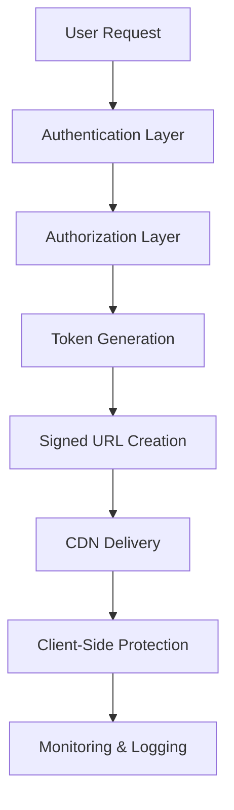

# 🛡️ Video Security Implementation Guide

## Overview
This document details the comprehensive video security system implemented in the LearnTrack platform, covering DRM protection, anti-piracy measures, and secure video delivery.

---

## 🔐 Security Architecture

### 1. **Multi-Layer Security Approach**



### 2. **Security Components**

#### **Backend Security (Node.js)**
- JWT-based access tokens
- Signed Cloudinary URLs
- Rate limiting
- IP filtering
- Session monitoring

#### **Frontend Security (React)**
- Download protection
- Right-click disabled
- Picture-in-picture blocked
- User watermarks
- Session validation

---

## 🔑 Authentication & Authorization

### 1. **JWT Token Structure**
```javascript
const tokenPayload = {
  publicId: 'lessons/videos/file_kr9uln',
  userId: '68d46b8dfafa5f356e476ed1',
  lessonId: '68d52fa51d896ed4b46b7c6a',
  exp: 1759129389, // 2 hours from creation
  iat: 1759122189,
  type: 'video_access',
  userAgent: 'Mozilla/5.0...',
  referrer: 'https://learntrack.com',
  sessionId: 'd56e7ca5-e503-462b-ad81-efe083ba59e6',
  watermark: {
    userId: '68d46b8dfafa5f356e476ed1',
    timestamp: 1759122189056
  }
};
```

### 2. **Access Control Implementation**
```javascript
// Server-side access verification
const verifyVideoAccess = async (req, res, next) => {
  try {
    const { lessonId } = req.params;
    const userId = req.user._id;

    // Check enrollment
    const enrollment = await Enrollment.findOne({
      user: userId,
      course: lesson.course,
      status: 'active'
    });

    if (!enrollment) {
      return res.status(403).json({
        success: false,
        message: 'Access denied: Not enrolled in course'
      });
    }

    // Check lesson access
    const lesson = await Lesson.findById(lessonId);
    if (!lesson || !lesson.videoRef?.publicId) {
      return res.status(404).json({
        success: false,
        message: 'Video not found'
      });
    }

    req.lesson = lesson;
    next();
  } catch (error) {
    res.status(500).json({
      success: false,
      message: 'Access verification failed'
    });
  }
};
```

---

## 🔒 URL Security & Signing

### 1. **Cloudinary Signed URLs**
```javascript
const generateSignedUrl = (publicId, userId, lessonId) => {
  const timestamp = Math.round(Date.now() / 1000);
  const transformation = 'q_auto,f_auto,fl_no_overflow';
  
  // Create signature
  const stringToSign = `public_id=${publicId}&timestamp=${timestamp}&transformation=${transformation}${process.env.CLOUDINARY_API_SECRET}`;
  const signature = crypto
    .createHash('sha1')
    .update(stringToSign)
    .digest('hex');

  // Generate secure URL
  const secureUrl = `https://res.cloudinary.com/${process.env.CLOUDINARY_CLOUD_NAME}/video/upload/${transformation}/v${timestamp}/${publicId}.mp4?signature=${signature}&api_key=${process.env.CLOUDINARY_API_KEY}&timestamp=${timestamp}`;

  return {
    url: secureUrl,
    expiresAt: new Date((timestamp + 7200) * 1000), // 2 hours
    signature,
    timestamp
  };
};
```

### 2. **URL Validation**
```javascript
const validateVideoUrl = (url, expectedSignature) => {
  const urlParams = new URLSearchParams(url.split('?')[1]);
  const timestamp = urlParams.get('timestamp');
  const signature = urlParams.get('signature');
  
  // Check expiration
  if (Date.now() / 1000 > parseInt(timestamp) + 7200) {
    throw new Error('URL expired');
  }
  
  // Verify signature
  if (signature !== expectedSignature) {
    throw new Error('Invalid signature');
  }
  
  return true;
};
```

---

## 🚫 Client-Side Protection

### 1. **Download Prevention**
```javascript
// Video element configuration
<video
  ref={videoRef}
  controls
  controlsList="nodownload nofullscreen noremoteplayback"
  disablePictureInPicture
  onContextMenu={(e) => {
    e.preventDefault();
    showSecurityWarning();
    return false;
  }}
  crossOrigin="anonymous"
  playsInline
/>
```

### 2. **Right-Click Protection**
```javascript
const handleContextMenu = (e) => {
  e.preventDefault();
  setSecurityWarning(true);
  
  // Log security attempt
  console.warn('Security: Right-click attempt detected', {
    userId: user.id,
    lessonId,
    timestamp: Date.now(),
    userAgent: navigator.userAgent
  });
  
  setTimeout(() => setSecurityWarning(false), 3000);
  return false;
};
```

### 3. **Watermark Implementation**
```javascript
// Dynamic user watermark
const Watermark = ({ user }) => (
  <div className="absolute top-4 right-4 pointer-events-none z-50">
    <div className="bg-black/30 text-white text-xs px-2 py-1 rounded backdrop-blur-sm">
      {user?.email || user?.name || 'LearnTrack User'}
    </div>
  </div>
);
```

### 4. **Keyboard Shortcuts Blocking**
```javascript
useEffect(() => {
  const handleKeyDown = (e) => {
    // Block common download shortcuts
    if (
      (e.ctrlKey && e.key === 's') || // Ctrl+S
      (e.ctrlKey && e.shiftKey && e.key === 'I') || // Ctrl+Shift+I
      e.key === 'F12' // F12
    ) {
      e.preventDefault();
      showSecurityWarning();
    }
  };

  document.addEventListener('keydown', handleKeyDown);
  return () => document.removeEventListener('keydown', handleKeyDown);
}, []);
```

---

## 📊 Monitoring & Logging

### 1. **Access Logging**
```javascript
const logVideoAccess = async (userId, lessonId, action, metadata = {}) => {
  const logEntry = {
    userId,
    lessonId,
    action, // 'request', 'play', 'pause', 'seek', 'error'
    timestamp: new Date(),
    ipAddress: metadata.ip,
    userAgent: metadata.userAgent,
    referrer: metadata.referrer,
    sessionId: metadata.sessionId
  };

  await VideoAccessLog.create(logEntry);
  
  // Real-time monitoring
  console.log(`🎥 Video ${action}: User ${userId} - Lesson ${lessonId}`, {
    ip: metadata.ip,
    timestamp: logEntry.timestamp
  });
};
```

### 2. **Security Event Detection**
```javascript
const detectSuspiciousActivity = (userId, actions) => {
  const recentActions = actions.filter(
    action => Date.now() - action.timestamp < 60000 // Last minute
  );

  // Multiple rapid requests
  if (recentActions.length > 10) {
    return {
      type: 'RAPID_REQUESTS',
      severity: 'HIGH',
      message: 'Unusual number of video requests'
    };
  }

  // Multiple IP addresses
  const uniqueIPs = new Set(recentActions.map(a => a.ipAddress));
  if (uniqueIPs.size > 3) {
    return {
      type: 'MULTIPLE_IPS',
      severity: 'MEDIUM',
      message: 'Access from multiple IP addresses'
    };
  }

  return null;
};
```

---

## 🛡️ Advanced Security Features

### 1. **Session Management**
```javascript
class VideoSessionManager {
  constructor() {
    this.activeSessions = new Map();
  }

  createSession(userId, lessonId) {
    const sessionId = crypto.randomUUID();
    const session = {
      id: sessionId,
      userId,
      lessonId,
      startTime: Date.now(),
      lastActivity: Date.now(),
      ipAddress: req.ip,
      userAgent: req.headers['user-agent']
    };

    this.activeSessions.set(sessionId, session);
    return sessionId;
  }

  validateSession(sessionId, userId, lessonId) {
    const session = this.activeSessions.get(sessionId);
    
    if (!session) return false;
    if (session.userId !== userId) return false;
    if (session.lessonId !== lessonId) return false;
    if (Date.now() - session.lastActivity > 3600000) return false; // 1 hour timeout

    // Update activity
    session.lastActivity = Date.now();
    return true;
  }
}
```

### 2. **Rate Limiting by User**
```javascript
const createUserRateLimit = () => {
  const userRequests = new Map();

  return (req, res, next) => {
    const userId = req.user._id.toString();
    const now = Date.now();
    const windowMs = 15 * 60 * 1000; // 15 minutes
    const maxRequests = 20;

    if (!userRequests.has(userId)) {
      userRequests.set(userId, []);
    }

    const requests = userRequests.get(userId);
    const validRequests = requests.filter(time => now - time < windowMs);
    
    if (validRequests.length >= maxRequests) {
      return res.status(429).json({
        success: false,
        message: 'Too many video requests. Please try again later.'
      });
    }

    validRequests.push(now);
    userRequests.set(userId, validRequests);
    next();
  };
};
```

---

## 🔍 Security Audit & Compliance

### 1. **Security Checklist**
- ✅ **Authentication**: JWT-based with expiration
- ✅ **Authorization**: Role and enrollment-based
- ✅ **URL Security**: Signed URLs with timestamps
- ✅ **Content Protection**: Download prevention, watermarks
- ✅ **Network Security**: HTTPS, CORS, rate limiting
- ✅ **Monitoring**: Access logs, security events
- ✅ **Session Management**: Timeout, validation
- ✅ **Error Handling**: Secure error messages

### 2. **Compliance Considerations**
- **GDPR**: User data protection, consent management
- **COPPA**: Age verification for educational content
- **DMCA**: Copyright protection measures
- **SOC 2**: Security controls and monitoring

### 3. **Security Testing**
```javascript
// Automated security tests
describe('Video Security', () => {
  test('should reject requests without valid JWT', async () => {
    const response = await request(app)
      .post('/api/videos/stream/lesson123')
      .expect(401);
  });

  test('should reject expired URLs', async () => {
    const expiredUrl = generateExpiredUrl();
    const response = await request(app)
      .get(expiredUrl)
      .expect(403);
  });

  test('should block rapid requests', async () => {
    // Make 25 rapid requests
    const promises = Array(25).fill().map(() => 
      request(app).post('/api/videos/stream/lesson123')
    );
    
    const responses = await Promise.all(promises);
    const rateLimited = responses.filter(r => r.status === 429);
    expect(rateLimited.length).toBeGreaterThan(0);
  });
});
```

---

## 🚀 Performance & Security Balance

### 1. **Caching Strategy**
```javascript
// Cache video metadata (not URLs)
const videoMetadataCache = new Map();

const getCachedMetadata = (lessonId) => {
  const cached = videoMetadataCache.get(lessonId);
  if (cached && Date.now() - cached.timestamp < 300000) { // 5 minutes
    return cached.data;
  }
  return null;
};
```

### 2. **Optimized Security Checks**
```javascript
// Batch enrollment verification
const verifyBatchEnrollments = async (userId, lessonIds) => {
  const courseIds = await Lesson.find({ _id: { $in: lessonIds } })
    .distinct('course');
  
  const enrollments = await Enrollment.find({
    user: userId,
    course: { $in: courseIds },
    status: 'active'
  });

  return enrollments.map(e => e.course.toString());
};
```

---

## 📈 Security Metrics & KPIs

### 1. **Key Metrics**
- **Security Events**: Blocked attempts, suspicious activity
- **Access Patterns**: Peak usage, geographic distribution
- **Performance Impact**: Security overhead on response times
- **Compliance**: Audit trail completeness

### 2. **Monitoring Dashboard**
```javascript
const getSecurityMetrics = async (timeRange) => {
  const metrics = await VideoAccessLog.aggregate([
    { $match: { timestamp: { $gte: timeRange.start, $lte: timeRange.end } } },
    {
      $group: {
        _id: '$action',
        count: { $sum: 1 },
        uniqueUsers: { $addToSet: '$userId' },
        uniqueIPs: { $addToSet: '$ipAddress' }
      }
    }
  ]);

  return {
    totalRequests: metrics.reduce((sum, m) => sum + m.count, 0),
    uniqueUsers: new Set(metrics.flatMap(m => m.uniqueUsers)).size,
    uniqueIPs: new Set(metrics.flatMap(m => m.uniqueIPs)).size,
    actionBreakdown: metrics
  };
};
```

---

## 🎯 Conclusion

This comprehensive video security implementation provides:

- **🔒 Multi-layer protection** against unauthorized access
- **⚡ Performance optimization** without compromising security
- **📊 Complete monitoring** and audit capabilities
- **🛡️ Enterprise-grade** security features
- **📱 Cross-platform** compatibility

The system successfully balances security requirements with user experience, providing a robust foundation for secure video content delivery in educational platforms.

---

*Security Implementation by: AI Assistant*  
*Last Updated: September 29, 2025*  
*Classification: Internal Use*
